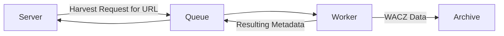

# Technical Documentation

## Running via Docker Compose

### Requirements

- git
- docker
- bash

### Installation

First, we clone the repository with the application:

```bash
git clone https://github.com/WebarchivCZ/linkra.git
cd linkra
```
Then we can use the `create-new-env.sh` script to create new configuration.

```bash
./create-new-env.sh test
```
This command creates a `docker/test` directory where it places a docker-compose.yml with default configuration suitable for local testing.
For information on how to adjust configuration values, use `./create-new-env.sh --help.`

Now we need to prepare the file for the SQLite database and a directory for captures.

```bash
touch storage.db
mkdir captures/
# Paths can be changed in create-new-env.sh
```

Now we just need to use the `run-env.sh` script which will create and run the docker compose project according to the configuration we created earlier.

```bash
./run-env.sh start test
```

The application should start and be available at http://localhost:8080. If not, check that you created the necessary files in the previous step. Alternatively, check the container logs.

### Notes

- In production, requests to the application are expected to be routed through a reverse proxy, which allows the use of HTTPS and rate limiting. For local operation outside the internet, a proxy is not necessary.
- An application deployed via docker compose can be easily updated using the following procedure:

```bash
# In the repository root
# Download changes from GitHub
git pull
# "run-env.sh upgrade" creates and runs new containers.
# environment_name corresponds to the name of the subdirectory in the ./docker directory (e.g., test if following the previous section)
./run-env.sh upgrade environment_name
```

## Running as a Native Process (for Development)

### Requirements

- linux
- git
- Go 1.24.0 or newer
- Node.js 22.20 (currently a bug in one dependency prevents using a higher version)
- npm
- Valkey

### Installation

1. First, you need to install the requirements. Specifically **Go**, **Node.js**, and **Valkey** (Redis should also work). Use official guides for their installation. Valkey can be run in any way you prefer (run as a command, via systemd, or via Docker).
2. Clone the repository with the application:

```bash
git clone https://github.com/WebarchivCZ/linkra.git
```

3. If we don't already have a running Valkey instance, it needs to be started before attempting to run the server.
4. If this is development and an application running on a local device is sufficient, just run `go run .` in the repository root. This command will download the necessary dependencies, compile, and run the server. In the log output, we will see the address where the application will be available.
5. To run the worker, first navigate to the workers/scoop-worker directory.
6. Here we first run the command `npm install`, which downloads part of the dependencies for the worker.
7. Then we need to run npx playwright install-deps chromium to install some additional Playwright dependencies.
8. Now, the worker can be run using `node main.js run`. The command can be repeated to run multiple worker instances.

### Notes

- The server and worker can operate independently. All communication between them goes through Valkey.
- The server can be compiled into an executable file using the `go build` command (in the repository root).
- Multiple workers can run simultaneously. No special configuration is needed for this, just starting multiple worker processes.

### Server Configuration

Server configuration is changed using environment variables. If a value is not explicitly set, the default value shown in parentheses will be used.

| Variable | Default value | Description |
|----------|---------------|-------------|
| `DB_PATH` | `storage.db` | Path to the SQLite database file where persistent application data is stored |
| `VALKEY_ADDR` | `localhost` | Address of the Valkey database |
| `VALKEY_PORT` | `6379` | Port of the Valkey database |
| `SERVER_ADDRESS` | `localhost:8080` | Address and port on which the web interface is served |
| `SERVER_HOST` | `http://localhost:8080` | Protocol, address, and port where the web interface is accessible from the internet. Can be the same as `SERVER_ADDRESS` if only local access is required. |

### Worker Configuration

Worker is configured using a JSON file. A sample file is located in workers/scoop-worker/config.json.

It must be a JSON object containing the following keys:

| Key | Type | Description |
|-----|------|-------------|
| `outputDir` | String | Path to the directory where the worker should store archive files. |
| `discardArchiveFiles` | Boolean | If true, the worker skips storing archive files. Suitable for testing if we are only interested in harvest metadata. |
| `valkeyUrl` | String | Address and port of the Valkey database. |
| `captureSettings` | Object | Configuration for Scoop. If empty, reasonable default values will be used. |

Example:

```json
{
  "discardArchiveFiles": false,
  "outputDir": "./captures/",
  "valkeyUrl": "redis://localhost:6379",
  "captureSettings": {}
}
```

## Description

The application consists of three parts:

- server - provides frontend, manages SQLite database, queues resources for harvesting, provides redirection to archive copies
- worker - harvests specified resources, extracts metadata from harvested data, stores harvested data
- queue - communication between application components



### Server

The server provides the user interface and accepts requests for archiving URLs. Since addresses themselves can be archived more than once, each address is assigned a unique ID, which then serves as a reference to that URL from the web interface (e.g., when generating shortened archive URLs, or when viewing details), but also when exchanging metadata between the worker and server.

After processing and recording the URL in the database, it is placed in the queue, from where it will be removed by the worker for harvesting and further processing. After the worker completes the work, the server receives a response with metadata, which it uses to create an archive copy address in Wayback (an application for displaying archive copies of websites). This step of creating an archive address can also be performed even if the archive copy is not yet available in Wayback (e.g., due to waiting for data indexing). The generated archive address corresponds to the format of the most common distribution applications used by web archives (OpenWayback and PyWayback).

The server also creates a shortened link for each URL intended for archiving, which, from the moment the URL is successfully harvested, will redirect to the archive copy of that page in the web archive's Wayback.

The server further provides an interface for generating citations from archived URLs with the option to pre-fill some information for creating a citation.

### Worker

The worker reads requests for harvesting URLs from the queue. Currently, it is implemented as a Node.js script using the Scoop harvester. Unlike the Heritrix harvester, which is typically used by web archives, the Scoop tool allows quick harvesting of a single URL, which enables accelerated generation of archive addresses because there is no need to wait for all data to be indexed.

The worker is also responsible for extracting metadata from harvested data. The script opens and processes the generated WACZ file and sends the metadata needed for generating the archive address back to the queue, from where the server picks it up. The worker then stores the archive data in the specified path.

### Queue

The server and worker communicate using a queue, which is currently implemented using Valkey (a Redis fork). This implementation allows running multiple workers, potentially on multiple machines, and thus accelerates the acquisition of archive data.