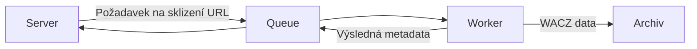

# Technická dokumentace

## Spuštění pomocí docker compose

### Požadavky

- git
- docker
- bash

### Instalace

Nejdříve naklonujeme repozitář s aplikací: 

```bash
git clone https://github.com/WebarchivCZ/linkra.git
cd linkra
```

Poté můžeme použít script `create-new-env.sh` pro vytvoření konfigurace.

```bash
./create-new-env.sh test
```

Tento příkaz vytvoří adresář `docker/test` kam vloží docker-compose.yml s výchozí konfigurací, vhodnou pro lokální testování.
Pro informaci jak upravit hodnoty konfigurace použijte `./create-new-env.sh --help`.

Teď je potřeba připravit soubor pro SQLite databázi a adresář pro archivní soubory.

```bash
touch storage.db
mkdir captures/
# Cesty možné upravit v crete-new-env.sh
```

Nyní stačí použít script `run-env.sh` který vytvoří a spustí docker compose projekt podle konfigurace kterou jsme předtím vytvořili.

```bash
./run-env.sh start test
```

Aplikace by se měla spustit a být dostupná na `http://localhost:8080`. Pokud ne zkontrolujte že jste v předchozím kroku vytvořili potřebné soubory. Případně zkontrolujte logy z kontejnerů.

### Poznámky

- Pro produkční provoz se počítá se směřováním dotazů na aplikaci skrze reverzní proxy, která umožní použití https a rate limiting. Pro lokální provoz mimo internet není proxy nutná.
- Aplikaci nasazenou pomocí docker compose je možné snadno aktualizovat pomocí následujícího postupu:

```bash
# V kořenu repozitáře
# Stáhneme změny z githubu
git pull
# "run-env.sh upgrade" vytvoří a spustí nové kontejnery.
# název_prostředí odpovídá názvu podadresáře v adresáři ./docker (např. test pokud postupujeme podle předchozí sekce)
./run-env.sh upgrade název_prostředí
```

## Spuštění jako nativní proces (pro vývoj)

### Požadavky

- linux
- git
- go 1.24.0 nebo novější
- nodejs 22.20 (aktuálně bug v jedné závislosti neumožňuje použít vyšší verzi)
- npm
- valkey

### Instalace

1. Nejprve je potřeba nainstalovat požadavky. Konkrétně **go**, **nodejs** a **valkey** (alternativně by mělo být možné použít redis). Použijte oficiální postupy pro jejich instalaci. V případě aplikace valkey je možné použít libovolnou variantu (spustit jako příkaz nebo pomocí systemd nebo dockeru).
2. Naklonujeme repozitář s aplikací:
```bash
git clone https://github.com/WebarchivCZ/linkra.git
```
3. Pokud ještě nemáme běžící instanci valkey, je potřeba ji spustit dříve, než se pokusíme spustit server.
4. Pokud jde o vývoj a dostačuje aplikace běžící na lokálním zařízení, stačí spustit `go run .` v kořeni repozitáře. Tento příkaz stáhne potřebné závislosti, zkompiluje a spustí server. Ve výstupu logu uvidíme adresu, na které bude aplikace dostupná.
5. Nyní, pokud chceme spustit i worker, tak přejdeme do adresáře `workers/scoop-worker`.
6. Zde nejprve spustíme příkaz `npm install`, který stáhne část závislostí pro worker.
7. Poté je potřeba ještě spustit `npx playwright install-deps chromium` pro doinstalování některých závislostí playwright.
8. Následně bude možné spustit worker pomocí `node main.js run`. Je možné příkaz opakovat a spustit více instancí worker.

### Poznámky

- Sever a worker mohou pracovat samostatně, veškerá komunikace mezi nimi probíhá skrze valkey.
- Server se dá pomocí příkazu `go build` (v kořeni repozitáře) zkompilovat do spustitelného souboru.
- Více workerů může běžet současně. Není k tomu potřeba žádná speciální konfigurace, pouze spuštění více worker procesů.

### Nastavení serveru

Nastavení serveru se mění pomocí proměnných prostředí. Pokud některá hodnota není explicitně nastavená, bude použita výchozí hodnota uvedená v závorce.

| Proměnná | Výchozí hodnota | Popis |
|----------|-----------------|-------|
| `DB_PATH` | `storage.db` | Cesta k souboru SQLite databáze, kam se ukládají perzistentní data aplikace |
| `VALKEY_ADDR` | `localhost` | Adresa, na které běží Valkey databáze |
| `VALKEY_PORT` | `6379` | Port, na kterém běží Valkey databáze |
| `SERVER_ADDRESS` | `localhost:8080` | Adresa a port, na kterém běží webové rozhraní serveru |
| `SERVER_HOST` | `http://localhost:8080` | Protokol, adresa a port, na kterém je webové rozhraní dostupné z internetu. Může být stejné jako `SERVER_ADDRESS`, pokud je vyžadován jen lokální přístup. |

### Nastavení workerů

Nastavení workerů se provádí pomocí JSON souboru. Vzorový soubor se nachází v `workers/scoop-worker/config.json`.

Musí to být JSON objekt, který obsahuje následující klíče:

| Klíč | Typ | Popis |
|------|-----|-------|
| `outputDir` | String | Cesta k adresáři, kam má worker ukládat archivní soubory. |
| `discardArchiveFiles` | Boolean | Pokud je `true`, worker přeskočí ukládání archivních soubory. Vhodné při testování, pokud nás zajímají pouze metadata sklizně. |
| `valkeyUrl` | String | Adresa a port Valkey databáze pro komunikaci se serverem. |
| `captureSettings` | Object | Konfigurace pro Scoop. Pokud je prázdný, použijí se rozumné výchozí hodnoty. |

Příklad:

```json
{
  "discardArchiveFiles": false,
  "outputDir": "./captures/",
  "valkeyUrl": "redis://localhost:6379",
  "captureSettings": {}
}
```

## Popis aplikace

Aplikace se skládá ze tří částí:

- server - poskytuje frontend, spravuje SQLite databázi, zařazuje zdroje ke sklizení, poskytuje přesměrování na archivní kopie
- worker - sklízí zadané zdroje, získává metadata ze sklizených dat, ukládá sklizená data
- queue (fronta) - komunikace mezi komponentami aplikace



### Server

Server poskytuje uživatelské rozhraní a přijímá požadavky na archivaci URL adres. Protože samotné adresy mohou být archivované více než jednou, je každé adrese přidělené jedinečné ID, které poté slouží k referenci dané URL adresy z webového rozhraní (např. při generování zkrácené archivní URL, nebo při zobrazení detailu), ale také při výměně metadat mezi workerem a serverem.

Po zpracování a zaznamenání URL do databáze je zařazena do fronty, odkud bude odebrána workerem ke sklizení a dalšímu zpracování. Poté, co worker dokončí práci, obdrží server odpověď s metadaty, která použije k vytvoření adresy archivní kopie ve waybacku (aplikaci k zobrazování archivních kopií webových stránek). Tento krok vytvoření archivní adresy je možné provést i v případě, že archivní kopie není zatím ve waybacku dostupná (např. z důvodu čekání na indexaci dat). Vygenerovaná archivní adresa odpovídá formátu nejběžnějších zpřístupňovacích aplikací používaných webovými archivy (Openwayback a PyWayback).

Server také pro každou URL určenou k archivaci vytvoří zkrácený link, který od chvíle, kdy dojde k úspěšnému sklizení URL, bude přesměrovávat na archivní kopii dané stránky ve waybacku webového archivu.

Server dále poskytuje rozhraní pro generování citací z archivovaných URL s možností předvyplnění některých informací pro vytvoření citace.

### Worker

Worker čte z fronty požadavky na sklizení URL adres. Aktuálně je implementován jako nodejs script s použitím sklízeče Scoop. Nástroj Scoop oproti např. sklízeči Heritrix, který je obvykle webovými archivy používán, umožňuje rychlé sklizení jedné URL, což umožňuje urychlené generování archivních adres, protože není potřeba čekat na zaindexování všech dat.

Worker je dále zodpovědný za extrakci metadat ze sklizených dat. Script otevře a zpracuje vygenerovaný WACZ soubor a odešle metadata potřebná pro generování archivní adresy zpátky do fronty, odkud si je převezme server. Worker poté uloží archivní data do specifikované cesty.

### Fronta

Server a worker komunikují pomocí fronty, která je aktuálně implementovaná pomocí Valkey (fork Redisu). Tato implementace umožňuje spustit více workerů, potenciálně i na více strojích a urychlit tak získávání archivních dat.
